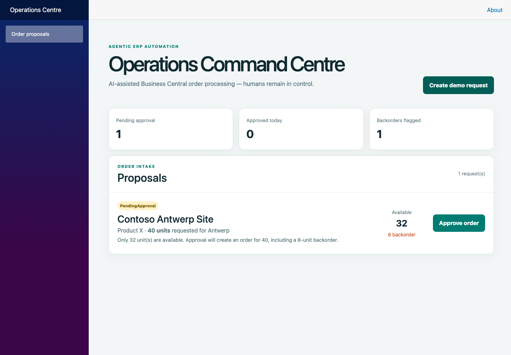
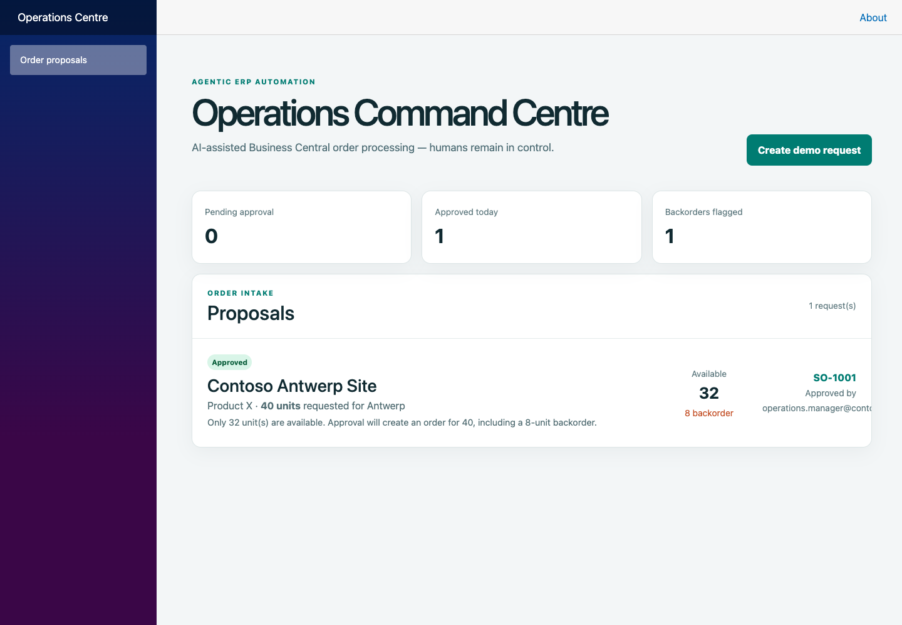

# Agentic Business Central Operations Platform

An AI-assisted ERP workflow showing how **Dynamics 365 Business Central**, **.NET 10**, and an agentic decision layer can streamline customer-order intake while retaining human control over every ERP mutation.

> Portfolio project for hybrid ERP / Business Central / AI consultancy roles. It deliberately uses a seeded Business Central adapter by default, so the entire workflow can be demonstrated without representing sandbox work as production experience.

## The business scenario

A customer sends an unstructured request such as: `Please order another 40 units of product X for our Antwerp site.`

The platform:

1. extracts structured order data;
2. resolves the customer and item through a Business Central client;
3. evaluates inventory and business rules;
4. creates a **proposal**, never an autonomous order;
5. requires an explicit approval; and
6. creates the sales order and immutable audit records.

```text
Customer request → extraction → BC lookup → rules → proposal → human approval → BC sales order
                                      ↘ audit trail ↗
```

## Highlights

- Clean-ish .NET solution split into Domain, Application, Infrastructure and API layers
- `IBusinessCentralClient` boundary with an in-memory demo adapter and a production-ready API adapter seam
- Deterministic structured extraction suitable for a demo; replace `OrderRequestExtractor` with Azure OpenAI / Copilot Studio orchestration in production
- Inventory/backorder decisioning, validation and explicit approval gate
- Correlation IDs and tamper-evident hash-chained audit events
- Executable end-to-end checks with no external services or packages
- GitHub Actions CI

## Run it

The demo runs entirely locally with seeded data: no Azure account, Business Central license, AI API key or paid cloud service is required. The API uses an in-memory Business Central simulator and deterministic request extraction.

Prerequisite: .NET SDK 10 and `curl`.

Start both the API and dashboard from the repository root:

```bash
bash scripts/run-local.sh
```

Open **http://localhost:5058** and click **Create demo request**, then **Approve order**. Press Ctrl+C in the terminal to stop both services. Proposals, orders, stock and audit events are demo data held in memory and reset when the API restarts.

Alternatively, with Docker running:

```bash
docker compose up --build
# Stop and remove the local containers afterwards:
docker compose down
```

Docker builds the images locally; it does not use Azure Container Registry. The native .NET path was verified on macOS on October 12, 2026; Docker Compose was reviewed but not run during that verification.

The API is at `http://localhost:5057`. You can also call the demo endpoints:

```bash
# Create a proposed order (does not write to Business Central)
curl -X POST http://localhost:5057/api/order-proposals \
  -H 'Content-Type: application/json' \
  -d '{"requestText":"Please order another 40 units of product X for our Antwerp site."}'

# View it and approve it using the returned proposal id
curl http://localhost:5057/api/order-proposals/{id}
curl -X POST http://localhost:5057/api/order-proposals/{id}/approve \
  -H 'Content-Type: application/json' \
  -d '{"approvedBy":"operations.manager@contoso.example"}'
```

Run verification:

```bash
dotnet run --project tests/AgenticOperations.Tests
```

## Demo and screenshots

[Follow the two-minute demo tour](docs/demo.md) or open [the offline screenshot showcase](docs/demo.html). Screenshots below were captured from the working local application on October 12, 2026 using seeded demo data.





## Cloud deployment and costs

Local development is the default. Azure deployment is **manual only**, with a default-off `enable_paid_azure` checkbox in GitHub Actions. Normal pushes and CI do not create Azure resources.

The former Azure demo used a Basic Container Registry with recurring daily charges, even when the apps were idle. See [the Azure retirement record](docs/azure-retirement.md). Existing charges remain payable; local execution has no Azure service charges. Azure infrastructure remains in `infra/` for a deliberate future redeployment, which will start recurring cloud charges again.

## Demo data

| Customer | Item | Requested | On hand | Result |
| --- | --- | ---: | ---: | --- |
| Antwerp Site (`ANTWERP`) | Product X (`PROD-X`) | 40 | 32 | Proposed with 8-unit backorder |
| Antwerp Site (`ANTWERP`) | Product Y (`PROD-Y`) | any | 120 | Proposed, fully available |

## Architecture and consultancy artefacts

- [Architecture](docs/architecture.md)
- [Business process / AS-IS and TO-BE](docs/business-process.md)
- [Requirements and UAT cases](docs/requirements.md)
- [Sample customer request](samples/customer-orders/antwerp-product-x.json)

## Business Central integration path

The default `DemoBusinessCentralClient` makes the repository safe and runnable. A real implementation belongs behind the same `IBusinessCentralClient` interface and should use:

- Microsoft Entra ID OAuth 2.0 client credentials;
- Business Central v2.0 API endpoints for companies, customers, items, sales orders and lines;
- an app registration with least-privilege permissions;
- a sandbox company for development and UAT; and
- idempotency / correlation tracking to protect against duplicate writes.

See [architecture.md](docs/architecture.md) for mapping detail. No credentials are committed, and no production Business Central instance is needed to run the demo.

## What this demonstrates

Business-process design, ERP integration boundaries, inventory exception handling, human-in-the-loop automation, API design, observability, testability, and responsible AI controls. It is hands-on project work—not a claim of production Business Central implementation experience.

## Next iterations

- add a real BC sandbox adapter and AL extension for a custom approval status;
- replace deterministic extraction with Azure OpenAI structured outputs;
- expose the workflow through Copilot Studio / Power Automate custom connector;
- persist orders and audit entries in PostgreSQL or Dataverse;
- add invoice-exception workflow.

## License

MIT. See [LICENSE](LICENSE).
