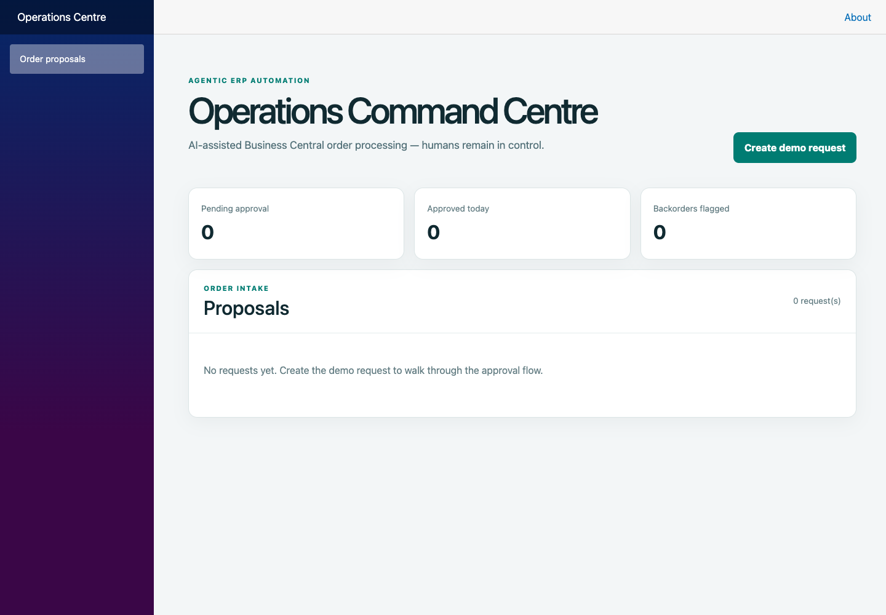

# Two-minute local demo tour

This is a seeded Business Central simulation with deterministic extraction, not a connection to a production ERP or a live AI model. No external service or credentials are needed.

Start with `bash scripts/run-local.sh` from the repo root, then open http://localhost:5058. Restart the API for fresh stock and empty proposals.

## 1. Open the Operations Command Centre (0:00–0:20)

The initial dashboard has zero pending approvals, approved orders and backorder flags.

## 2. Create a proposal (0:20–1:00)

Click **Create demo request**. The request asks for 40 units of Product X for Antwerp. The seeded stock is 32, so the proposal flags an 8-unit backorder. Its status is `PendingApproval`; no sales order has been created yet.

## 3. Approve the order (1:00–1:30)

Click **Approve order**. The demo creates `SO-1001`, records the approver and changes the proposal to `Approved`. The dashboard now shows one approved order and zero pending approvals.

## 4. Inspect the audit trail (1:30–2:00)

Get the proposal ID from http://localhost:5057/api/order-proposals, then open `/api/order-proposals/{id}/audit` on the same host. Expect three hash-chained events: `RequestExtracted`, `ProposalCreated` and `SalesOrderCreated`.

Audit data and orders are in memory. Restarting clears them. This walkthrough verifies a local demo workflow, not production authentication, durability or concurrent operation.

## Saved evidence

- [Offline screenshot showcase](demo.html), usable without a running app or hosting.
- [12-second screenshot tour video](screenshots/local-demo.mp4), a slideshow of the three captured states.
- [Former Azure overview](screenshots/azure-overview.png), captured before retirement. The cloud create action returned a response-parsing error during capture; the screenshots of the complete successful workflow above are from localhost.

Captured October 12, 2026, with a 1440 × 1000 desktop viewport. The local create → pending/backorder → approval flow, three-event audit trail and existing executable end-to-end checks were verified. No relevant browser console errors occurred in the local run. Docker and mobile viewports were not tested.
